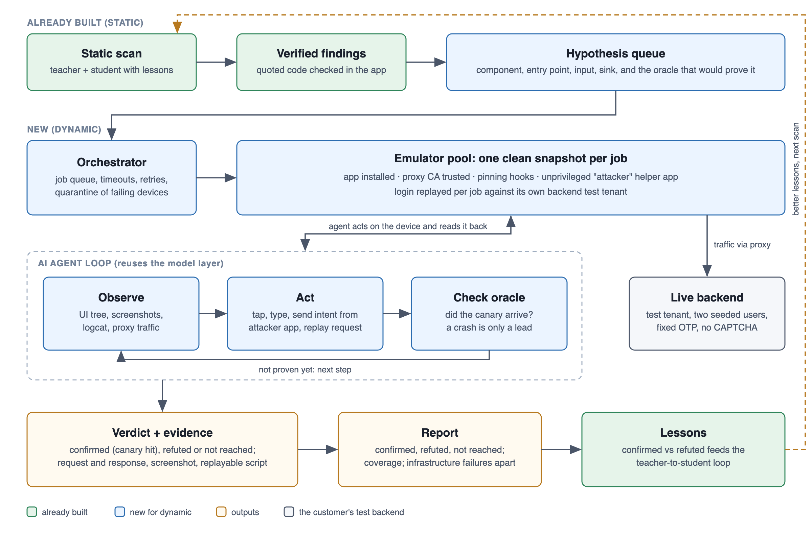

# Dynamic analysis: extending the static scanner

Diagram source: [`dynamic-diagram.html`](dynamic-diagram.html).

**Extending this system.** Reading code can only say a bug might be there; running the app can prove it. So each finding from the static scan becomes a claim to test: an AI agent runs the app against its real backend and tries the attack. It reuses the scanner's models and finding format, and adds tools: device control, a proxy to watch traffic, hooks inside the app, and a small "attacker" app. What is proved or disproved feeds the lessons.

**Confirming, not crashing.** The root problem: a successful attack is usually silent. A stolen file causes no error. So before each attack the agent fixes what proof will look like, and plants a unique marker. A web address only the agent knows appears in the app's traffic. A file hidden in the app's private storage comes back out. Logged in as user A, it receives user B's data. Attacks come from the ordinary attacker app, never from the developer tool (adb), which has rights no real attacker has. A crash is only a hint.

**Reaching the right screen.** The root problem: most bugs sit behind a login, and an agent cannot receive an SMS code or solve a CAPTCHA. So it gets ordinary test accounts, and the test backend accepts a fixed code. That is fair: a real attacker just signs up, and the test account has no rights a normal user lacks. The agent jumps straight to any screen the static scan found open to other apps. Many screens stay unreachable: one study found tools rarely reach 30% of an app's screens. So unreached screens are reported, and coverage is measured as screens reached, app code actually run, and server endpoints seen.

**Scale.** The root problem: an emulator is slow to set up and carries leftovers from the last test. So a ready device is saved once as a snapshot (app installed, traffic watching set up) and every job starts from it. A reset is then a restore that takes seconds, not a reinstall that takes minutes. No job depends on another, so many emulators run side by side. The server keeps leftovers too, so each job uses its own test account. A job that hangs is stopped and retried on a fresh emulator, and one that never finished is reported as not tested, never as safe.

**SSL pinning.** The root problem: app traffic is encrypted, and a pinned app accepts only its own server's certificate, so it refuses a proxy in the middle. Two things are needed: the test device must trust the proxy's certificate, and the app's own check must be switched off with a hook while it runs. What breaks most often: (1) since Android 14 the system certificate list is read-only, so the proxy's certificate has to be added for each app separately; (2) the hook cannot find the check, because build tools rename the code it looks for, and apps built with Flutter or their own network code ignore the device's settings; (3) the app or its server detects a modified device and refuses to work.

**Only dynamic catches it:** a missing permission check on the server (IDOR). As user A I ask for order 1001, which is mine. I change the number to 1002 and get user B's order. The check that should stop this lives on the server, so the app's code looks the same whether the server checks or not.
